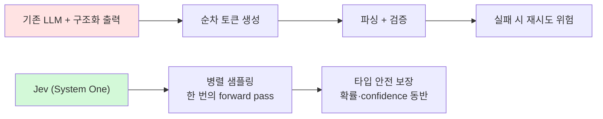

> **TL;DR**
> TypeSafe AI가 2026-09-15 공개한 **Jev**는 문장을 쓰지 못하는 대신 70~500ms 만에 타입된 확률적 결정(Choice/Score/Noul)을 반환하는 "System One 모델"이다. LLM보다 최대 200x 빠르고 1/200 저렴하며, 라우팅·분류·가드레일 같은 "smart if-statement" 자리에 끼워 넣는 계층으로 쓴다. 이 글은 원리, 검증된 활용 패턴 5가지, 실패 모드까지 정리한다.
{: .prompt-info }

## 1. 개요

Jev — TypeSafe AI의 첫 System One Model

| 항목 | 내용 |
|------|------|
| 개발사 | TypeSafe AI (창업자 Diogo Almeida, OpenAI RLHF/InstructGPT 연구 공동 저자) |
| 발표 | 2026-09-15, 2년 스텔스 후 (투자 $40M, DCVC 리드) |
| 입출력 | 비정형 state 입력 → **타입된 확률적 결정** 출력 (텍스트 생성 불가) |
| 지연 | 70ms~500ms end-to-end (프론티어 LLM: 3~329초) |
| 가격 | 입력 $0.042/MTok, **출력 무료** |
| 질의 타입 | Choice(최대 255옵션) / Score(2~10단계 척도) / Noul(yes-no 확률) |
| 컨텍스트 | 64k 토큰, 텍스트만 |
| 접근 | typesafe.ai 웨이리스트 early access, Vercel AI 게이트웨이 |

이름은 경제학자 William Stanley Jevons에서 왔다 — 제임스 와트 효과처럼, 지능 가격이 한 자릿수 이상 떨어질 때마다 사용례가 폭증한다는 베팅이다. "System One"은 Kahneman의 빠른 직관적 사고에서.

## 2. 왜 새로운가 — autoregressive를 버린다

먼저 감을 잡아보자. 고객 문의가 들어왔을 때 "이게 결제/기술/영업 중 무엇인가?", "환불을 원하는가?", "얼마나 화가 났는가?"를 판단해 분기하고 싶다. 지금이라면 LLM에게 JSON을 요청하고, 몇 초를 기다린 뒤, 파싱이 실패했는지 검사한다. Jev는 이 "판단" 부분만 떼어낸 부품이다 — 같은 질문을 던지면 **0.3초 안에 타입 안전한 답 + 확신도**가 온다.

기존 LLM은 토큰을 순차적으로 생성한다. 구조화 출력(JSON)도 결국 `{`, `"answer"`, `:` ... 을 한 토큰씩 forward pass로 만든 뒤 파싱·검증해야 한다. Jev는 구조화 출력**만** 하도록 설계돼 모든 질문을 **한 번의 병렬 forward pass**로 응답한다.



학습도 다르다. RLHF가 "인간이 선호하는 답"을 최적화한다면, Jev의 **RLCD**(Reinforcement Learning for Calibrated Decisions)는 "정확한 결정 + 정직한 확신도"를 최적화한다. 덕분에 confidence가 상향식으로 의미 있어서, `confidence < 0.5면 사람에게` 같은 라우팅이 실제로 작동한다.

성능(주의: TypeSafe 자체 평가) — 4-workflow eval에서 67.8%로 GPT-5.6 Terra(67.9%)와 동급, Opus 5(73.1%)보다는 낮지만 비용 1/200·지연 1/50. Claude Sonnet 5도 정확히 67.8%인데 293x 비용, 195x 지연이었다.

## 3. 세 가지 원시 타입이 전부다

```python
from typesafe_sdk import Choice, Noul, Score, TypeSafeClient

client = TypeSafeClient()
response = client.system_one(
    state={
        "ticket": {"subject": "Duplicate charge",
                   "messages": [{"from": "customer",
                                 "text": "I was charged twice for order A-104."}]},
        "refund_policy": "Duplicate charges are eligible for a refund.",
    },
    questions={
        "department":      Choice(instructions="Which team should handle this",
                                  criteria={"billing": "Payment or subscription issues",
                                            "technical": "Bugs or integration problems",
                                            "sales": "Pricing or account questions"}),
        "frustration":     Score(instructions="How frustrated the customer appears",
                                 criteria=["Calm, just stating facts",
                                           "Frustrated but civil",
                                           "Very angry, strong language"]),
        "refund_requested": Noul(instructions="The customer is explicitly asking for a refund"),
    },
)
print(response.answers["department"].choice)        # billing
print(response.answers["frustration"].score)        # 1.03 (레벨 사이 값 가능)
print(response.answers["refund_requested"].noul)    # 0.94
```

- **Choice**: 옵션 최대 255개. 전체 목록을 통째로 넘겨라. `other` 옵션을 명시해 "아무것도 안 맞음"을 표현하게 하라. 한국어 예: "이 문의는 어느 팀 담당인가?" → 결제/기술/영업/기타
- **Score**: 서술형 척도(2~10단계). 인덱스는 배열 순서. 예: "고객이 얼마나 불만인가?" → 침착함 / 불만 있으나 정중 / 매우 격앙
- **Noul**: 0~1 확률 하나. confidence 필드 없음 — 그 숫자 자체가 신뢰도. 예: "고객이 환불을 명시적으로 요구하는가?" → 0.94

호출은 SDK 없이도 가능하다 — 엔드포인트 하나뿐이라 언어 무관(Java/Kotlin에서도 그냥 HTTP 클라이언트로 호출):

```bash
curl -X POST https://api.typesafe.ai/v1/systemone \
  -H "Authorization: Bearer $TYPESAFE_API_KEY" \
  -d '{"state": "…", "questions": {…}}'
```

운영 관점: 두 SDK 모두 429 시 지수 백오프 재시도 + `retry-after` 준수. Jev 응답 상한이 500ms이므로 클라이언트 타임아웃은 1초 내로 잡고, 실패 시 디폴트 라우팅(사람 or 규칙 기반)으로 떨어지는 fallback을 코드에 두는 것이 안전하다.

## 4. 활용 패턴 5가지

### 패턴 1 — Speculative Fan-out
질문이 병렬 평가되므로 **질문 10개 추가는 토큰비만 있고 시간은 거의 무료**다. "싼 호출 먼저" 관습을 버리고 처음부터 다 물어라. TypeSafe cookbook에서 13개 질문 배칭은 개별 호출 대비 12.2x 저렴·10x 빠름, 답은 동일했다.

### 패턴 2 — Confidence-Gated Routing
```python
if action.confidence < 0.5:
    route_to_human(msg)                    # 바닥: 확실히 모름
elif action.choice == "approve_transfer":
    if action.confidence > 0.85:           # 돈을 옮김: 높은 bar
        approve_transfer(account_id)
    else:
        ask_user_to_confirm("Approve this transfer?")
```
액션의 실패 비용에 따라 임계값을 따로 설계한다. 확률 분포가 평평하면 모델이 헷갈린 게 아니라 **criteria가 틀렸다는 신호**다.

### 패턴 3 — Composite Scoring
"이 후보가 좋은가"를 하나의 질문에 숨기지 말고 독립 차원(Python 깊이 / 리더십 / 시스템 설계)으로 쪼개 각각 Score로 물은 뒤, 가중치는 내 코드에서:

```python
composite = (0.40 * a["python_depth"].score / 4 +
             0.25 * a["team_leadership"].score / 4 +
             0.35 * a["system_design"].score / 4)
```
재가중치가 리프롬프트가 아니라 코드 변경이 된다.

### 패턴 4 — The Cascade
Jev는 프론티어 LLM을 대체하는 게 아니라 **누가 프론티어를 쓸 자격이 있는지 결정하는 계층**이다.

```python
r = client.system_one(state=message, questions={
    "intent": Choice(...),
    "complexity": Score(...),
})
if r.answers["intent"].choice == "order_status":
    return lookup_order(message)                  # 순수 코드, LLM 없음
if r.answers["intent"].choice == "complaint":
    if r.answers["complexity"].score > 1:
        return route_to_human(message)
    return handle_with_llm(message, COMPLAINT_RESOLUTION)
```

백만 티켓 기준 대략 **$6,480 vs $30,400**, 약 80만 건이 0.5초 내 처리된다. (산식: TypeSafe 공개 per-case 비용 기준 — Jev 약 $0.0004/case, LLM 라우팅 약 $0.03/case. 원문의 가정치라 실제 트래픽에서는 달라질 수 있다.)

### 패턴 5 — Retrieve, then Judge
Jev는 state 외의 세상을 모른다. state가 오염되면 오염된 자료에 대한 "잘 보정된 판단"을 내릴 뿐이다. 따라서 코드로 정확히 검색·필터하고 필요한 필드만 넘겨라. RAG 패시지마다 Noul로 관련성을 먼저 걸면, 필터 비용이 절약하는 컨텍스트 창보다 싸다.

## 5. 출시 48시간 만에 나온 것들

| 프로젝트 | 내용 | 수치 |
|------|------|------|
| [1kpapers.com](https://1kpapers.com/) | 논문 1,018편 요약+분류 | 요약 $3.99, 분류 $0.08, 중앙 지연 256ms |
| [browser-use/jev-ultrafast](https://github.com/browser-use/jev-ultrafast) (641★) | 브라우저 에이전트 항공권 예약 | 7.1초, $0.0039 |
| [typesafe-computer-use](https://github.com/awlevin/typesafe-computer-use) | OCR+Jev로 Mac 조작 (스크린샷 없음) | 스텝당 $0.0002 vs Opus 5 $0.032 |
| [jev-trader](https://github.com/jarrodwatts/jev-trader) | ~300ms 블록마다 매매 결정 | 모델 지연 ~81ms |
| [jev-drone](https://github.com/RomanSlack/jev-drone) | 드론 자율비행 | 제어 500Hz는 코드, 판단만 Jev 2.5Hz (advisory) |

공통 패턴: **루프·안전·연산은 일반 코드, Jev는 그 가운데 좁은 판단만.**

## 6. 실패 모드 — 배포 전에 읽을 것

TypeSafe가 스스로 공개한 "jaggedness" 목록:

- **문자 그대로 읽는다** — 부정어, 범위 한정어, 암묵적 조건이 표면 그대로 처리됨. "내가 진짜 뜻한 것"을 설명하고 있다면 그게 instruction에 빠진 절반이다
- **계산기를 대신하지 못한다** — 세는 것은 코드로 반복하고 항목당 Noul 하나
- **날짜는 텍스트일 뿐** — 순서·간격 비교 불가. 열거형 Choice + "not stated"로 우회
- **Context rot** — 질문에 불필요한 자료가 state에 차면 정확도 하락. 먼저 필터
- **state는 적대적으로 취급되지 않는다** — 사용자 제어 텍스트가 분류를 조작하려 할 수 있음. 위협 모델은 내 몫
- **생성을 못 한다** — 텍스트·코드·요약 불가. 자유 텍스트에서 값 추출이 필요하면 regex/생성 모델로 후보를 얻고 Jev가 고른다

> 코드가 정확히 계산할 수 있는 것을 모델에 묻지 마라. 하나의 질문에 여러 판단을 숨기지 마라.

## 7. 비판 — 이 모든 게 정말 새로운가

회의적 시각도 분명하다. Sean Goedecke는 **기술적 해자가 얇다**고 본다: 일반 LLM에 `"choice": "`를 프리필하고 옵션에 맞는 단일 토큰만 제약 생성하면, Jev의 속도·일관성·병렬성 대부분을 재현할 수 있다는 것. 그는 Qwen2.5-1.5B로 직접 실험해 2~3x 속도 향상을 확인했다. 실제로 오픈소스 [openjev](https://github.com/TheoLeeCJ/openjev)는 4B 모델의 logit에서 한 forward pass로 타입된 옵션 확률을 읽어 인터페이스 패턴을 재현했다.

"환각이 없다"는 주장도 좁게 읽어야 한다 — 스키마 밖 값을 반환할 **수 없을** 뿐, **잘못된 유효값**은 얼마든지 반환한다. 0% 타입 오류는 측정치가 아니라 구조적 주장이고, 벤치마크 수치는 전부 TypeSafe 자체 운영이라 독립 재현이 없다. 가격 보조금 여부도 장기적으로 증명해야 한다.

프리필 비판에 대한 옹호 측 논리도 분명하다. Goedecke 스스로 "구조화 출력만을 위해 파인튜닝/최적화된 모델은 유의미한 우위일 것"이라고 단서를 달았다 — 프리필 트릭은 긴 형태의 구조화 출력이나 보정(calibration) 품질까지 재현한다는 보장이 없고, Jev의 RLCD는 confidence가 높으면 실제 정확도도 높다는 집계적 보정을 학습 목표로 삼는다. confidence-gated 라우팅(패턴 2)의 신뢰성은 결국 이 보정에 달려 있는데, ECE 같은 보정 지표나 도메인 시프트 상황(학습 분포 밖 입력에서 confidence가 무너지는지)에 대한 독립 검증은 아직 공개되지 않았다. 도입 전에는 자기 트래픽으로 confidence-정확도 상관관계를 직접 측정해보는 것이 안전하다.

한 가지 더 짚을 것: "4-workflow eval"의 67.8%는 정확도가 아니라 **GPT-6 Astra와 Claude Fable 5.1의 고사고 모드 평균(합의 라벨)과의 일치도**다. ground truth가 없어서 Astra와 Fable 자신은 결과표에 없으며, OpenAI/Anthropic 모델에 유리한 구조라는 게 TypeSafe 본인들의 인정이다.

그래도 방향은 유의미하다. "빠른 구조화 출력"이 진짜 새로운 계산 원시형이 되면, 지금까지 챗봇 형태로만 존재하던 AI가 **요청 핸들러 안의 sub-second 판단 계층**으로 들어갈 자리가 생긴다. 프론티어 모델이 그 자리를 200x 비용으로 채우는 건 낭비였고, 그 낭비를 정리하는 것이 Jev의 몫이다.

## 8. 언제 쓰나

- **Yes**: 라우팅·트리아지, 검열, 비싼 컨텍스트 앞 단계 필터링, LLM 출력 가드레일/검증, 대량 태깅, sub-second 판단
- **No**: 생성 전반, 산술/카운팅/날짜 계산, 감사용 근거 서열, 일회성 복잡 추론, 열린 답 공간

유용한 관점 전환: 이건 싼 LLM이 아니라 **타입을 반환하고 자신을 얼마나 믿을 수 있는지 알려주는, 지능적인 함수 호출**이다. 그렇게 보면 문자열 출력을 견디기 위해 존재하던 코드들이 하나둘 필요 없어진다.

## 참고

- [Introducing System One Models & Jev — TypeSafe AI](https://typesafe.ai/blog/introducing-system-one-models-and-jev)
- [How to Use Jev: A practical guide — DEV Community](https://dev.to/valyuai/how-to-use-jev-a-practical-guide-to-typesafes-system-one-model-g5e)
- [Jev means structured output is interesting again — Sean Goedecke](https://seangoedecke.com/jev-means-structured-output-is-interesting-again/)
- [Jev docs](https://docs.typesafe.ai/) · [evals](https://evals.typesafe.ai/)
