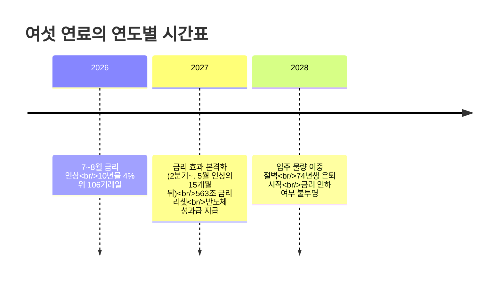

> **TL;DR**
> 서울 집값 88주 연속 상승의 배면에는 금리라는 스위치가 있다. 고금리의 타격은 5~15개월 시차를 두고 오고, 2027년엔 563조 원 주담대의 금리가 다시 정해진다. "부동산 불패"는 한국은행이 금리를 찍어누른 동안의 착시였다는 분석.
{: .prompt-info }

## 1. 개요

박종훈의 지식한방(2026-10-17) 영상 **"부동산 불패의 비밀, 값싼 돈이 끝났다"** (16분 57초) 정리.

| 항목 | 내용 |
|------|------|
| 채널 | 박종훈의 지식한방 |
| 업로드 | 2026-10-17 |
| 핵심 주장 | 집값은 금리가 결정한다 — 공급이 아니라 |
| 핵심 경고 | 2027년 563조 원 주담대 금리 리셋 |
| 분석 프레임 | 여섯 연료: 금리·규제·주식·보너스·공급·인구 |

## 2. 현재: 88주 연속 상승, 그러나 강남은 이미 하락

서울 아파트가 **88주 연속 상승하며 누적 +17.9%** 올랐다 — 통계 집계 이래 최장 상승. 그런데 디테일이 다르다:

- **강남구**: 10주 연속 하락, 최근 주간 -0.35% (서초 -0.27%, 송파 -0.21%)
- **성북구**: 올해 누적 +14.9%로 뒤늦게 급등

"기록을 만든 동네가 먼저 멈췄다" — 상승 주도권이 강남에서 비강남으로 이동하는 국면 전환 신호라는 것.

## 3. 집값은 누구 탓? — 금리 60.7%

국토연구원 분석(2023, 2011~2021 아파트가격 변동 기여도):

| 요인 | 기여도 |
|------|--------|
| **기준금리** | **60.7%** |
| 대출 규제 | 17.9% |
| 주택 공급 | 8.5% |
| 인구 구조 | 8.5% |
| 경기 | 4.4% |

주택 공급은 8.5%에 불과하다. 공급을 아무리 늘려도 기준금리를 내리면 집값은 급등하는 구조라는 것. 영상의 표현을 빌리면 **"금리는 연료가 아니라 스위치다"**.

## 4. 금리가 집값을 꺾는 방식 — 2022년 복기

부동산 불패로 불리는 강남도 금리 앞에선 무력했다.

- 레고랜드 사태로 10년물 국고체 **4.63%**까지 상승, 4% 초과는 **7주(33거래일)**뿐
- 그 7주 동안 2022년 10월 서울 아파트 거래 **558건** — 통계 이래 최저
- 실거래가 한 해 **-22%** 하락

당시엔 둔촌주공 사태 이후 정부·한은이 부양책과 금리 인하로 대응, 2023년 1월부터 집값이 반등했다.

### 시차의 법칙

고금리의 타격은 바로 오지 않는다.

- **미국 2006년**: 기준금리 5.25%까지 인상 → 집값 하락은 **15개월 뒤** 시작 → 2012년까지 **-27%** (일부 도시 -50%)
- **2026년 현재**: 금리 인상이 5월부터였다면 연체·매도 압력은 **15개월 뒤 ≈ 2027년 8월**부터 본격화

### 고정이 버티고, 변동은 꺾인다

2022~23년 금리 인상기의 국가별 주택가격 하락 폭:

| 국가 | 하락 폭 | 비고 |
|------|---------|------|
| 미국 | -5.0% | 30년 고정 90%, 이후 +4.6% 반등 |
| 영국 | -5.3% | |
| 호주 | -7.5% | |
| 독일 | -12.9% | |
| 캐나다 | -14.1% | |
| 스웨덴 | -15% | |
| 뉴질랜드 | -17.6% | |
| **서울(2022 실거래)** | **-22%** | 신규 대출의 76.5%가 변동금리 |

같은 금리 인상이어도 **변동금리 비중이 높은 나라일수록 하락 폭이 크다**. 한국이 최악이었던 이유다.

## 5. 2026년은 2022년보다 나쁘다

금리 수준 자체는 2022년과 비슷하다 — 10년물 약 4.6%, 신규 주담대 4.6%대(2022년 피크 4.8%). 그런데 두 가지가 다르다:

1. **지속 기간**: 2022년엔 4% 초과가 7주였지만, 지금은 **4% 위 106거래일** — 축적된 타격의 크기가 다른 차원
2. **가계 부채**: 가계신용 **2,020조 원** (2019년 말 1,600조 대비 급증), 은행 연체율 **0.63%**로 이미 10년 최고

### 2027년, 563조의 금리가 다시 정해진다

결정적 차이는 대출 구조다. 2021~22년 금리가 오를 때 많은 사람이 **5년 고정 혼합형** 대출을 받았다. 이 대출의 5년이 2026년 4분기부터 만료되면서 변동금리로 전환된다.

- 전환 시 금리: **2.70% → 4.26%**
- 3억 원 대출 기준 월 상환: **122만 → 148만 원**
- 금리가 다시 정해지는 주담대 잔액: 3Q26 144조 → 4Q26 165조(최대) → **2027년 연간 563조**

영상의 표현: **"미국 2007년의 리셋이 한국에선 2027년에 온다."**

## 6. 그럼 왜 아직도 오르나 — 남은 연료

### 시차
금리 효과가 도착하지 않았다. 대출 금리엔 ~5개월, 연체엔 ~15개월의 시차가 있다.

### 주식 머니
자금출처 조사에서 최근 부동산 매수자의 **70%가 주식 매도 자금**으로 샀다. 주가가 고점(9,100) 대비 **-38%** 하락한 지금, 이 연료는 소진되는 중.

### 반도체 보너스
삼성전자·SK하이닉스의 호실적 성과급이 남아 있는 연료. 삼성전자 직원 10만 명+, DS 사업부 비중이 큰 만큼 **내년(2027) 봄 성과급 지급이 집값 상승 연료**가 될 수 있다 — 특히 동탄 같은 반도체 인력 거주 지역.

### 공급 부족
서울 입주 물량이 2025~26년 수만 수준에서 **2027년 2.3만 → 2028년 1.5만 가구**로 줄어든다. 게다가 재건축·재개발로 전세 수요가 2028년 4.5만, 2030년 5.7만 가구 발생해 전세값을 밀어올릴 수 있다. 다만 기여도 8.5%의 항목 — 금리만 못하다.

### 인구
74년생(막내 베이비부머)이 지금 52세. 통계청 평균 퇴직 나이 53세(남성 55세). **2028년부터 은퇴가 집중되며 신규 주택 수요 둔화**라는 장기 하방 요인.

## 7. 연도별 시간표 — 승부는 금리

정리하면:

- **2027년**은 상방 연료(성과급·공급 부족)와 하방 압력(금리 효과·563조 리셋)이 정면 충돌하는 해
- 승부는 결국 **금리** — 한국은행의 신호와 10년물 국고채 금리를 매달 확인하는 것이 핵심
- 물가가 오르는 상황에서 금리를 못 내리면, "값싼 돈"의 시대는 끝난다

> 유튜브 단일 채널의 분석이라는 점은 감안하자. 특히 2027~28년 전망은 발표자 본인도 "방향만 제시, 숫자 없음"이라고 명시한 시나리오다. 저자의 도서 『가짜돈 진짜 부』 5~6장 소개도 포함되어 있다.
{: .prompt-warning}

## 참고

- 원본 영상: [부동산 불패의 비밀, 값싼 돈이 끝났다 (박종훈의 지식한방)](https://youtu.be/R4K0qIgCK9Y)
- 국토연구원 「주택시장과 통화금융정책의 영향관계 분석」 (2023) — 슬라이드 인용
- 한국부동산원 주간 동향, 한국은행 ECOS — 슬라이드 인용
